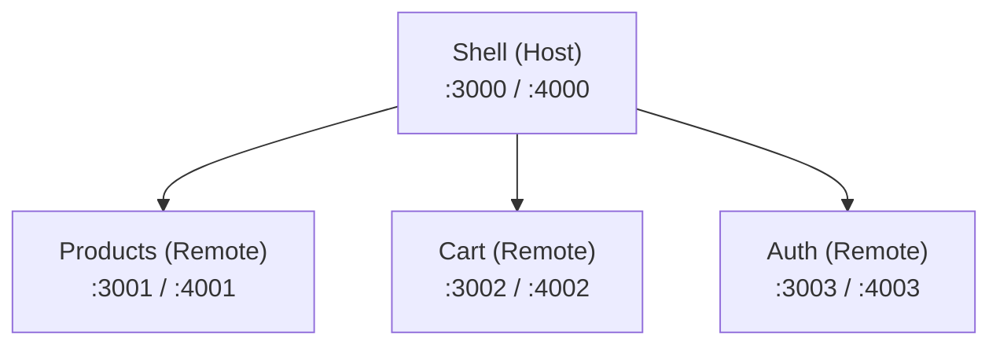

# Micro Frontend Monorepo

A scalable Micro Frontend architecture built with **React, TypeScript, Vite, Module Federation, and pnpm Workspaces**.

This project demonstrates how to split a frontend application into independently developed and built applications while maintaining a unified development environment through a Monorepo.

## Architecture

The project consists of four independent applications:

| Application | Role | Development Port | Preview Port |
|---|---|---:|---:|
| Shell | Host application | 3000 | 4000 |
| Products | Products remote | 3001 | 4001 |
| Cart | Shopping cart remote | 3002 | 4002 |
| Auth | Authentication remote | 3003 | 4003 |

### Architecture Overview



The Shell application acts as the host and consumes exposed modules from the remote applications using Module Federation.

## Tech Stack

- React
- TypeScript
- Vite
- Module Federation (`@module-federation/vite`)
- pnpm Workspaces
- ESLint

## Project Structure

```text
micro-frontend-monorepo/
│
├── apps/
│   ├── shell/
│   ├── products/
│   ├── cart/
│   └── auth/
│
├── package.json
├── pnpm-workspace.yaml
└── README.md
```

## Key Features

- Micro Frontend architecture using Module Federation.
- Monorepo management with pnpm Workspaces.
- Independent applications with separate development servers.
- Remote module integration through a host application.
- Shared React and React DOM dependencies.
- Environment-based remote configuration.
- Independent production builds.
- Production build preview for all applications.
- Centralized development, build, preview, and lint commands.

## Getting Started

### Prerequisites

- Node.js
- pnpm

### Installation

```bash
git clone https://github.com/YOUR_USERNAME/micro-frontend-monorepo.git

cd micro-frontend-monorepo

pnpm install
```

### Development

Run all applications simultaneously:

```bash
pnpm dev
```

Or run an individual application:

```bash
pnpm dev:shell
pnpm dev:products
pnpm dev:cart
pnpm dev:auth
```

### Production Build

Build all applications:

```bash
pnpm build
```

Build an individual application:

```bash
pnpm build:shell
pnpm build:products
pnpm build:cart
pnpm build:auth
```

### Production Preview

Start all preview servers:

```bash
pnpm preview
```

### Lint

```bash
pnpm lint
```

## Environment Configuration

Remote entry URLs are configured through a centralized `.env` file in the Shell application.

Development remotes:

```env
VITE_PRODUCTS_DEV=http://localhost:3001/remoteEntry.js
VITE_CART_DEV=http://localhost:3002/remoteEntry.js
VITE_AUTH_DEV=http://localhost:3003/remoteEntry.js
```

Production preview remotes:

```env
VITE_PRODUCTS_PREVIEW=http://localhost:4001/remoteEntry.js
VITE_CART_PREVIEW=http://localhost:4002/remoteEntry.js
VITE_AUTH_PREVIEW=http://localhost:4003/remoteEntry.js
```

Vite's mode-based configuration selects the appropriate remote URLs during development and production builds.

## Monorepo vs. Micro Frontend

These two concepts solve different architectural problems:

**Monorepo** is a codebase management strategy that allows multiple applications and packages to live in a single repository.

**Micro Frontend** is an architectural approach that divides a frontend application into smaller, independently developed and deployable parts.

This project combines both approaches:

- pnpm Workspaces manages the applications within one repository.
- Module Federation enables runtime integration between independently built frontend applications.

## Learning Objectives

This project explores:

1. Micro Frontend architecture and its trade-offs.
2. Module Federation and remote module loading.
3. Host and remote application responsibilities.
4. Monorepo management using pnpm Workspaces.
5. Shared dependencies between federated applications.
6. Environment-based configuration.
7. Independent builds and production preview workflows.

## Future Improvements

- CI/CD integration.
- Automated testing.
- Independent deployment pipelines.
- Runtime remote configuration.
- Error boundaries and remote loading fallbacks.
- Shared design system and component library.
- Docker-based deployment.
- Production hosting with Nginx.

## License

MIT